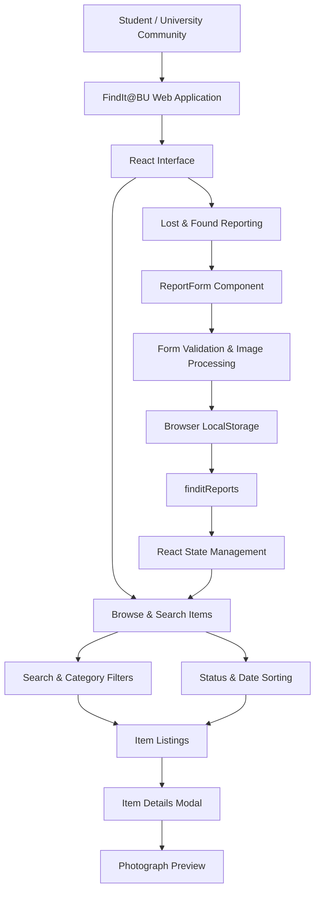

# 🔎 FindIt@BU

> **Smart Campus Lost & Found System** — A React-based university Lost and Found platform designed to help students and faculty report, discover, and reconnect lost belongings across Bennett University. Built with React, Vite, and Tailwind CSS, the application provides an intuitive interface for reporting lost and found items, browsing campus listings, and accessing item information.

---

## ⚡ Overview

**FindIt@BU** is a campus-focused digital Lost and Found platform developed to simplify the process of recovering misplaced belongings within Bennett University.

Losing personal belongings in a university environment can be frustrating. Traditional methods of finding lost items often depend on word of mouth, physical notices, or informal communication.

FindIt@BU aims to provide a centralized platform where students and members of the university community can report lost or found belongings and browse available reports.

The application provides an organized interface for submitting item information, searching existing listings, and viewing relevant details.

### Core Application Modules

- **Lost Item Reporting:** Submit reports for belongings misplaced on campus.
- **Found Item Reporting:** Report belongings discovered within the university.
- **Item Browsing:** Explore reported lost and found items through a centralized listing interface.
- **Search & Filtering:** Find relevant reports using keywords, categories, and item status.
- **Item Details:** Access detailed information about individual reported belongings.
- **Photo Upload:** Attach photographs to reports to make item identification easier.
- **Local Data Persistence:** Store submitted reports using browser LocalStorage.

---

## 🎯 Key Features

### 1. Interactive Home Page

A centralized landing page designed to provide quick access to the platform's primary functionalities.

- Modern and responsive landing page.
- Dedicated Bennett University branding.
- Direct access to Lost Item and Found Item reporting.
- Navigation to Browse Items, How It Works, and About sections.
- Mobile-friendly navigation menu.
- Search interface for quickly locating reported belongings.

### 2. Lost & Found Item Reporting

The platform provides separate reporting workflows for lost and found belongings.

Users can submit information through dedicated reporting forms.

**Report Form Fields:**

| **Field** | **Description** |
|---|---|
| Item Name | Name or identification of the belonging. |
| Category | Classification of the reported item. |
| Description | Details such as colour, brand, and identifying features. |
| Location | Place where the item was lost or found. |
| Date | Date the item was lost or found. |
| Photograph | Optional item photograph. |
| Full Name | Name of the person submitting the report. |
| University Email | Contact email address. |
| Phone Number | Optional contact number. |

**Reporting Features:**

- Separate Lost and Found reporting forms.
- Required field validation.
- Category selection.
- Item description input.
- Location and date information.
- Image upload with preview.
- Image removal before submission.
- Image format validation for JPG, PNG, and WEBP.
- Maximum image upload size of 5 MB.
- Submission confirmation.
- Automatic storage of submitted reports.

### 3. Item Categories

FindIt@BU organizes reported belongings into five major categories.

| **Category** | **Examples** |
|---|---|
| Electronics | Smartphones, chargers, earbuds, USB drives. |
| Personal Belongings | Wallets, keys, spectacles, watches. |
| Academic Items | Books, notebooks, calculators, files. |
| University Property | ID cards, access cards, laboratory equipment. |
| Other Items | Water bottles, umbrellas, bags. |

Users can explore individual categories directly from the home page or filter listings using the category selection interface.

### 4. Browse & Search Items

A centralized browsing section allows users to explore reported belongings.

**Search Functionality:**

- Search using item names.
- Search by category.
- Search by location.
- Search through item descriptions.
- Search by Lost or Found status.
- Clear search input when required.

**Filtering Options:**

| **Filter** | **Available Options** |
|---|---|
| Category | All, Electronics, Personal Belongings, Academic Items, University Property, Other Items. |
| Status | All Items, Lost Items, Found Items. |
| Sorting | Newest First, Oldest First. |

Additional functionality:

- Dynamic filtering of item listings.
- Category-based navigation.
- Chronological sorting.
- Responsive item card layout.
- Empty-state message when no matching reports are available.
- Direct access to individual item information.

### 5. Item Details & Photograph Preview

Each reported item provides a dedicated details view.

**Available Information:**

- Item name.
- Lost or Found status.
- Category.
- Location.
- Date.
- Description.
- Reporter name.
- Contact email.
- Phone number, when provided.
- Uploaded item photograph.

**Image Features:**

- Display uploaded photographs.
- Open photographs in an enlarged preview.
- Close the image preview using the close control or background interaction.

This functionality helps users identify belongings through their descriptions and photographs.

### 6. Local Data Storage

The current application uses the browser's LocalStorage API to maintain submitted reports.

**Storage Implementation:**

- Reports are stored under the `finditReports` LocalStorage key.
- New reports are added to the beginning of the stored collection.
- Item photographs are converted into Base64 data URLs.
- Previously submitted reports are loaded when the application initializes.
- React state updates when new reports are submitted.
- A custom browser event (`reportsUpdated`) synchronizes report updates across application components.

**Important:** The current implementation uses browser-based storage. Reports are not synchronized across different users, browsers, or devices.

---

## 🔐 Data Handling & Security Considerations

FindIt@BU currently uses client-side storage and does not have a connected backend or centralized database.

Important considerations:

- Report information is stored locally in the user's browser.
- No server-side authentication is currently implemented.
- No centralized user account management is available.
- Contact information is collected through the reporting form.
- Uploaded photographs are stored as Base64 data.
- Browser LocalStorage limitations apply to stored reports and photographs.

**Important:** The current implementation is a frontend prototype. It should not be treated as a production-ready centralized Lost and Found management system. Backend integration, access control, and secure data management would be required for a production deployment.

---

## 🎨 Design & User Experience

The platform follows a modern campus-oriented interface focused on accessibility, simplicity, and ease of navigation.

Design priorities include:

- Clean and modern user interface.
- Blue-themed visual identity.
- Responsive layouts for desktop and mobile devices.
- Organized category-based navigation.
- Interactive item cards.
- Clear Lost and Found status indicators.
- Consistent form layouts.
- Image previews and enlarged photograph viewing.
- Intuitive reporting and browsing workflows.
- Smooth hover and transition effects.

---

## 🛠️ Technology Stack

| **Technology** | **Purpose** |
|---|---|
| [React](https://react.dev/) | Component-based user interface development. |
| [Vite](https://vite.dev/) | Frontend development server and build tool. |
| [JavaScript (ES Modules)](https://developer.mozilla.org/en-US/docs/Web/JavaScript) | Application logic and functionality. |
| [Tailwind CSS](https://tailwindcss.com/) | Utility-first styling and responsive layouts. |
| [Lucide React](https://lucide.dev/) | Interface icons. |
| Browser LocalStorage | Client-side report persistence. |
| React Hooks | Component state and lifecycle management. |
| HTML5 | Application structure and form elements. |
| CSS3 | Additional styling and presentation. |

---

## 🏗️ System Architecture

FindIt@BU currently follows a client-side React application architecture.

The application uses React components to manage reporting workflows, item browsing, search, filtering, and item details.

### Architecture Diagram



### Architecture Components

- **Frontend:** React-based single-page application.
- **Build System:** Vite.
- **Styling:** Tailwind CSS.
- **Reporting Module:** Dedicated Lost and Found reporting component.
- **State Management:** React `useState` and `useEffect`.
- **Data Persistence:** Browser LocalStorage.
- **Image Processing:** FileReader API and Base64 data URLs.
- **Search System:** Client-side keyword matching and filtering.

---

## 📁 Project Structure

The project follows a component-based React and Vite structure.

```text
findit-bu/
│
├── public/
│   ├── favicon.svg
│   └── icons.svg
│
├── src/
│   ├── assets/
│   │   ├── hero.png
│   │   ├── react.svg
│   │   └── vite.svg
│   │
│   ├── App.jsx              # Main application and UI logic
│   ├── App.css              # Application-specific styles
│   ├── index.css            # Global styles and Tailwind import
│   ├── ReportForm.jsx       # Lost and Found reporting forms
│   └── main.jsx             # React application entry point
│
├── index.html               # HTML entry point
├── vite.config.js           # Vite configuration
├── package.json             # Dependencies and scripts
├── package-lock.json        # Dependency lock file
├── .gitignore
└── README.md
```

*Note: This represents the current high-level project structure.*

---

## ⚙️ Getting Started

### Prerequisites

Install the following before running the application:

- [Node.js](https://nodejs.org/)
- npm (included with Node.js)
- Git
- A code editor such as Visual Studio Code

### 1. Clone the Repository

```bash
git clone YOUR_GITHUB_REPOSITORY_URL

cd findit-bu
```

Replace `YOUR_GITHUB_REPOSITORY_URL` with the actual GitHub repository URL.

### 2. Install Dependencies

```bash
npm install
```

This installs the dependencies required to run the application.

### 3. Run the Development Server

```bash
npm run dev
```

Vite will start the local development server.

Open the following address in your browser:

```text
http://localhost:5173
```

The FindIt@BU application will now be available locally.

---

## 📜 Available Commands

| **Command** | **Description** |
|---|---|
| `npm install` | Install project dependencies. |
| `npm run dev` | Start the Vite development server. |
| `npm run build` | Generate the production build. |
| `npm run preview` | Preview the production build locally. |
| `npm run lint` | Run Oxlint code analysis. |

---

## 🚀 Deployment

FindIt@BU uses Vite and can be deployed using static hosting platforms such as:

- [Vercel](https://vercel.com/)
- [Netlify](https://www.netlify.com/)
- [GitHub Pages](https://pages.github.com/)

### Production Build

Generate the optimized production build:

```bash
npm run build
```

Vite generates the production-ready application inside the `dist/` directory.

### Deployment Process

1. Push the project repository to GitHub.
2. Connect the GitHub repository to your preferred hosting platform.
3. Select Vite as the frontend framework.
4. Configure the build command as `npm run build`.
5. Set the output directory to `dist`.
6. Deploy the application.
7. Test the reporting, browsing, search, and filtering functionality.

**Deployment Consideration:** Since reports are stored in browser LocalStorage, deploying the frontend does not create a shared database. Each user's browser maintains its own report collection.

---

## 🔄 Application Workflow

The primary application workflow is:

```text
Student / University Community
          |
          v
     FindIt@BU
          |
          v
    Choose an Action
          |
     +----+----+
     |         |
     v         v
 Report Lost  Report Found
     |         |
     +----+----+
          |
          v
    Fill Report Form
          |
          v
   Submit Item Details
          |
          v
    LocalStorage
          |
          v
   Browse Reported Items
          |
          v
 Search / Filter / Sort
          |
          v
    View Item Details
          |
          v
  Reconnect with Owner
```

---

## 📌 Project Goals

FindIt@BU aims to provide:

- A centralized digital platform for campus Lost and Found reporting.
- A convenient way to report misplaced belongings.
- Better visibility of found items across the university.
- Organized item categorization.
- Faster discovery through search and filtering.
- Improved identification through item photographs.
- A simple and accessible user experience.
- A foundation for a future university-wide Lost and Found management system.

---

## 🔮 Future Enhancements

Potential improvements for future versions include:

- Backend integration with Supabase or another database.
- University email authentication.
- Centralized reporting accessible across multiple devices.
- Administrator dashboard for managing reports.
- Report verification and moderation.
- Item claim and ownership verification workflow.
- Notifications when matching lost and found reports are submitted.
- Secure contact and communication system.
- Report status tracking.
- Improved data privacy and access control.

---

## 👨‍💻 Development

**Project:** FindIt@BU  
**Project Type:** Smart Lost and Found System  
**Institution:** Bennett University  
**Framework:** React + Vite  
**Styling:** Tailwind CSS  
**Data Storage:** Browser LocalStorage  
**Project Category:** Student TREP End-Term Group Project

---

## 📄 License

This project is developed as part of a university academic project at Bennett University.

Usage, modification, and distribution are subject to the repository owner's permissions.
